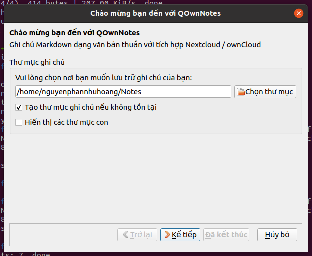
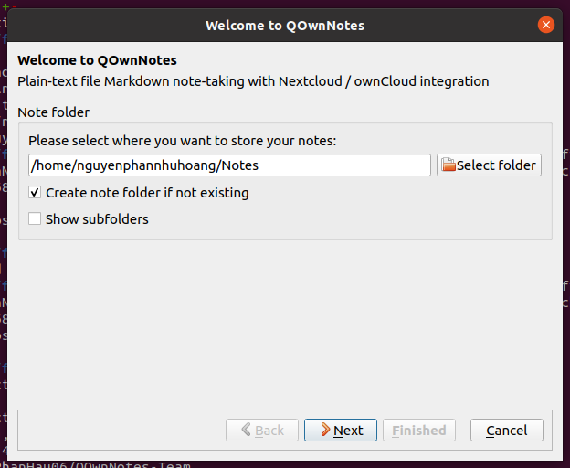
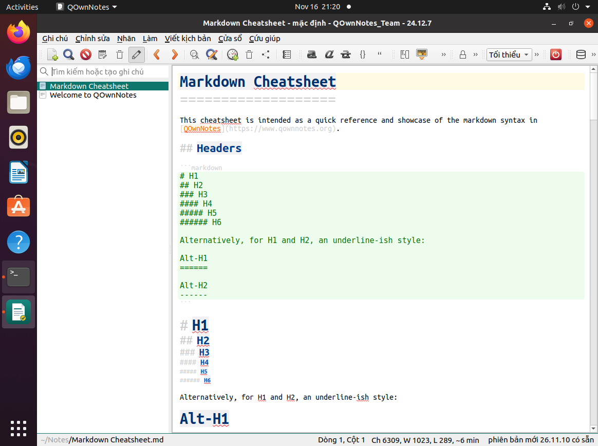
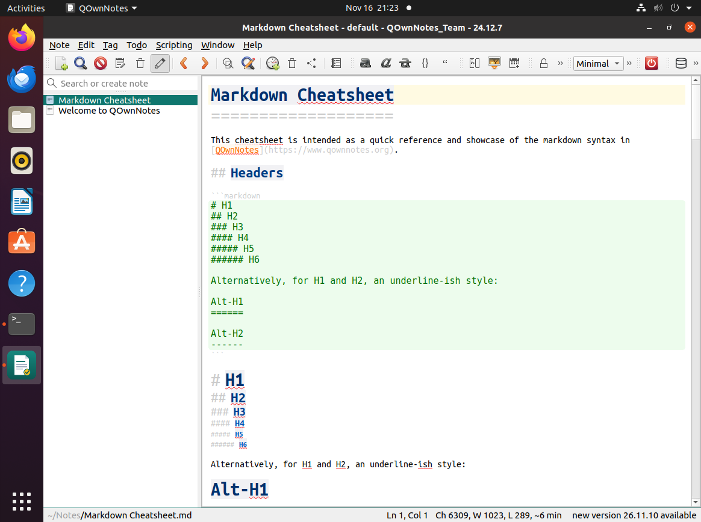
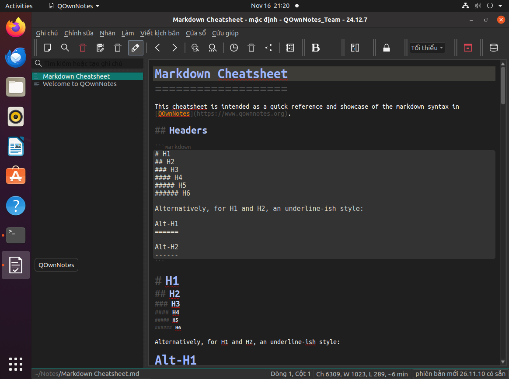
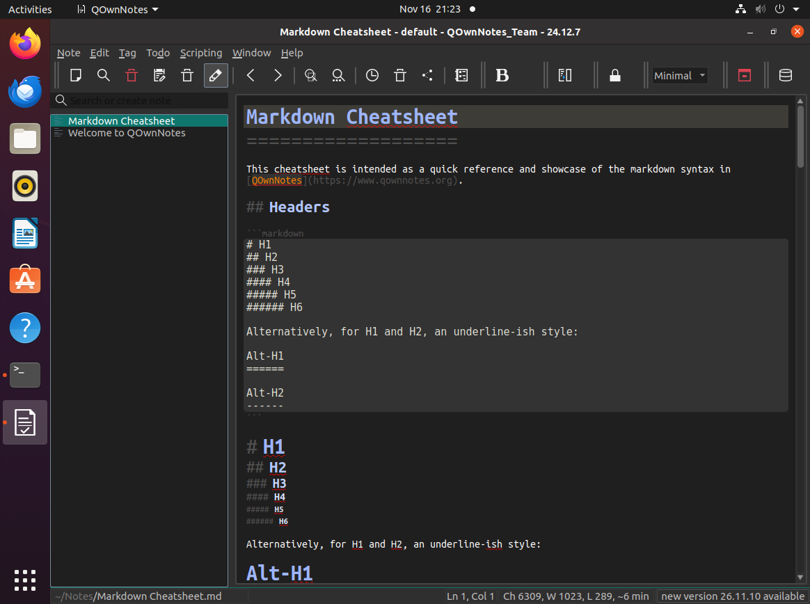

# Báo cáo Người 4 — Giao diện tiếng Anh và nhận diện

**Người thực hiện:** Nhu Hoang
**Nhánh / PR:** `feature/team-icons`, PR #17 vào `dev`
**Môi trường thử:** Ubuntu 20.04.4 LTS (VM), Qt 5.12.8, GCC 9.4.0, GUI chạy trực tiếp trên desktop VM

## 1. Phạm vi

Theo `docs/PHAN_CONG_HOAN_THIEN.md`, phần của Người 4 gồm: English là ngôn ngữ mặc định, giữ lựa chọn của người dùng cũ, tên `QOwnNotes_Team`, icon, chế độ sáng/tối và ảnh nghiệm thu.

Giảng viên yêu cầu giao diện ứng dụng hoàn toàn bằng tiếng Anh. Vì vậy ngoài các việc trên, nhóm đã gỡ tiếng Việt khỏi app. Báo cáo này vẫn viết bằng tiếng Việt.

## 2. Thay đổi đã thực hiện

| Nội dung | File |
|---|---|
| Icon app mới (ô vuông teal, tờ ghi chú, dấu check) và icon đơn sắc cho khay/nền tối | `icons/icon.svg`, `icons/icon-dark.svg`, `src/images/icon*.png`, `src/images/icons/*/apps/QOwnNotes.png`, bản SVG tương ứng |
| Tiêu đề menu khay và hộp thoại thông báo hiện `QOwnNotes_Team` | `src/mainwindow.cpp` |
| English là mặc định cho cấu hình mới (fix của Người 1, commit `42e8c21`, được đưa vào nhánh này vì `dev` chưa có) | `src/main.cpp` |
| Gỡ tiếng Việt khỏi app: bỏ mục "Tiếng Việt" ở Settings, bỏ `QOwnNotes_vi.ts` khỏi `.pro`, CMake, gói `.deb`, bỏ các dòng `[vi]` trong `.desktop` | `src/dialogs/settingsdialog.ui`, `src/QOwnNotes.pro`, `src/CMakeLists.txt`, `src/debian/qownnotes.install`, `src/PBE.QOwnNotes.desktop`, `scripts/build.sh`, `scripts/package-deb.sh`, `src/languages/QOwnNotes_vi.ts` (xóa) |
| Script kiểm tra trước/sau trên VM | `scripts/ui-check.sh` |

Lưu ý: Người 1 dùng `scripts/package-deb.sh`, file này vừa bị bỏ dòng kiểm tra `QOwnNotes_vi.qm`. Cần build lại `.deb` sau khi PR được merge.

## 3. Cách kiểm tra

`scripts/ui-check.sh` build hai bản trong thư mục tạm và chạy chúng với cấu hình tạm (`XDG_CONFIG_HOME`, `XDG_DATA_HOME`), nên không đụng vào cấu hình cá nhân:

- **Bản trước:** `origin/dev`, commit `4ec8b0e`.
- **Bản sau:** `origin/feature/team-icons`, commit `9ef34c7` trở đi (các commit sau chỉ sửa script).

Quy trình: build cả hai, chạy ba ca cấu hình, rồi chụp màn hình bằng `scrot` ở lần chạy đầu, chế độ sáng và chế độ tối. Chế độ tối được bật bằng đúng các khóa của `Utils::Misc::switchToDarkOrLightMode`.

## 4. Kết quả

### 4.1. Ngôn ngữ mặc định

Log đầy đủ: `docs/screenshots/config-check.txt`.

| Ca | Bản trước (`dev`) | Bản sau |
|---|---|---|
| [A] Cấu hình mới | `interfaceLanguage=vi` (lỗi) | `interfaceLanguage=en` (đạt) |
| [B] Người dùng cũ chọn `de`, có `notesPath` | giữ `de` | giữ `de`, không áp dụng mặc định của nhóm |
| [C] Người dùng chọn `de`, chưa có `notesPath` | `vi` (ghi đè, lỗi cũ) | giữ `de` (đạt) |

### 4.2. Ảnh trước/sau

**Màn hình chào lần đầu**

| Trước (tiếng Việt) | Sau (tiếng Anh) |
|---|---|
|  |  |

**Cửa sổ chính, chế độ sáng**

| Trước | Sau |
|---|---|
|  |  |

**Cửa sổ chính, chế độ tối**

| Trước | Sau |
|---|---|
|  |  |

Nhận xét từ ảnh:
- Menu, thanh công cụ, danh sách ghi chú và thanh trạng thái bản sau đều bằng tiếng Anh.
- Tiêu đề cửa sổ là `... - QOwnNotes_Team - 24.12.7` ở cả hai chế độ.
- Icon mới hiện ở dock (chế độ sáng). Ở chế độ tối, dock hiện icon trắng đơn sắc.
- Màu nhấn teal đọc rõ ở mục đang chọn trong danh sách và menu, cả hai chế độ. Chữ không bị cắt ở các vùng đã chụp.

## 5. Chưa kiểm tra

- **Icon trên khay hệ thống:** GNOME mặc định trên VM không hiện khay, nên chưa xem được. Tiêu đề menu khay mới sửa trong mã.
- **Menu Ubuntu / `.desktop`:** chạy từ thư mục build thì GNOME lấy tên `QOwnNotes` từ `WM_CLASS`. Tên `QOwnNotes_Team` chỉ kiểm tra được sau khi cài `.deb`. Cần làm cùng Người 1.
- **About và Settings:** lần này không chụp About, Settings hay các hộp thoại khác. Mục "Tiếng Việt" đã bị gỡ khỏi danh sách ngôn ngữ trong mã (`settingsdialog.ui`) nhưng chưa xem trực quan.
- **Bản `.deb`:** chưa kiểm tra giao diện trong gói cài.
- **Thông báo "new version 26.11.10 available" ở thanh trạng thái:** là thông báo cập nhật của QOwnNotes gốc, nằm ngoài phạm vi này.

## 6. Cách chạy lại

Trong clone repo trên VM:

```bash
bash scripts/ui-check.sh build
bash scripts/ui-check.sh config
bash scripts/ui-check.sh shots
```

`config` và `build` chạy được qua SSH. `shots` phải chạy trong terminal trên desktop VM. Có thể giới hạn bản cần chạy: `NAMES=after bash scripts/ui-check.sh shots`.
